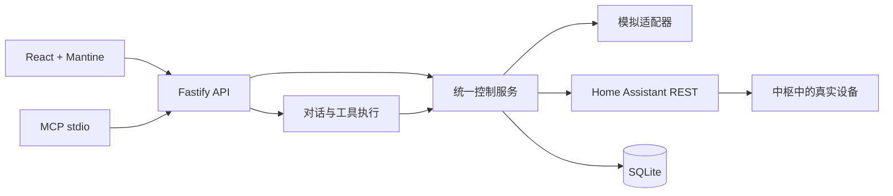

# 架构与边界

Home Hub 面向单家庭、本地单进程部署。当前交付是无硬件的“设备读取 → 手动/对话控制 → 结果回读 → 持久化记录”链路。

## 模块与数据流

| 位置 | 职责 |
| --- | --- |
| `src/` | 控制台、设备卡片、户型、场景和对话；服务端为状态权威 |
| `shared/types.ts` | 共享设备、场景、事件、消息类型 |
| `server/hub.ts` | 能力校验、串行控制、场景执行和同步 |
| `server/home-assistant.ts` | 实体映射、服务调用与状态回读 |
| `server/agent.ts` | 工具定义、有限本地语法和模型调用循环 |
| `server/store.ts` | SQLite 数据、演示初始化和保留策略 |
| `server/app.ts`、`server/mcp.ts` | HTTP 与 MCP 入口；MCP 复用运行中的 HTTP 服务 |

使用 TypeScript 单服务使开发和部署可以一次启动。设备通过 capabilities 声明可控制字段；品牌与协议仅为元数据，不通过品牌字符串分派控制。首版包含模拟和 Home Assistant 两种适配器，没有预建空协议插件层。

## 状态与失败

控制前验证设备存在、在线、能力、数值范围及互斥参数。执行前持久化 pending 记录，回读达到目标后记为 success。网络错误、回读失败或尚未到达目标记为 uncertain，不自动重发；重启后未完成记录也转为 uncertain。

控制、场景和中枢同步使用进程内串行队列。场景先校验全部目标，首次执行失败即停止，已完成步骤不回滚。当前不支持多进程共同写库或跨重启自动补发。

网页每 5 秒读取本地快照，操作后立即刷新。Home Assistant 仅在手动同步和控制回读时更新，尚无 WebSocket 订阅；其他客户端造成的变化需要同步。桥接设备在服务重启后显示离线，直到成功同步。

SQLite 使用 WAL，保存设备、场景、消息和记录。保留最近 100 条消息、200 条事件；页面返回最近 50 条事件。当前没有账号、多家庭或独立会话隔离，共享令牌代表家庭的全部读写权限。

## Agent 与权限

网页对话与 MCP 共用 get_home、control_device、activate_scene。工具调用再次经过服务端校验；模型最多运行 6 轮、12 次工具调用，失败调用或部分失败场景会停止后续操作。执行回执来自实际记录。

未配置模型时仅识别明确设备、房间类型、“所有灯”及场景名称；不把有限语法称作大语言模型。否定、疑问和复合表达不会触发控制。配置模型后发送必要设备上下文与最近对话，真实模型理解质量需要额外联调。

默认仅监听 loopback。局域网监听必须提供共享令牌；API 校验匹配后的路由、令牌和请求来源。密钥只在服务端读取，不进入快照、提示词或浏览器构建。

## 后续阶段

1. 用户提供设备和中枢后，联调真实能力映射、温度单位与回读延迟。
2. 实现 Home Assistant 状态订阅与重连；按真实需求再选原生 MQTT/Matter 等适配器。
3. 根据产品需求加入多用户权限、危险操作确认、定时自动化与独立对话会话。
4. 提供真实户型后替换示例映射；户型编辑、媒体、摄像头、门锁和能源统计尚未实现。

验证范围统一见[测试说明](testing.md)。
